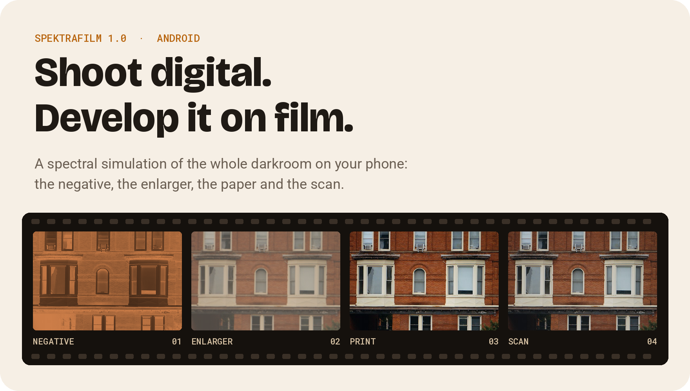
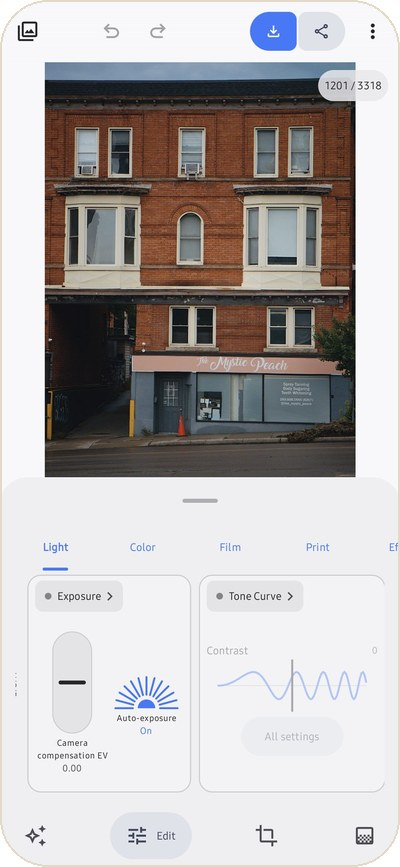
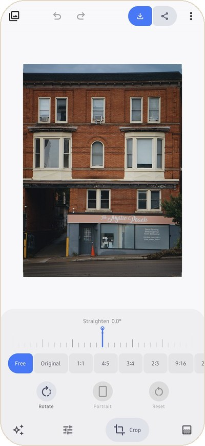
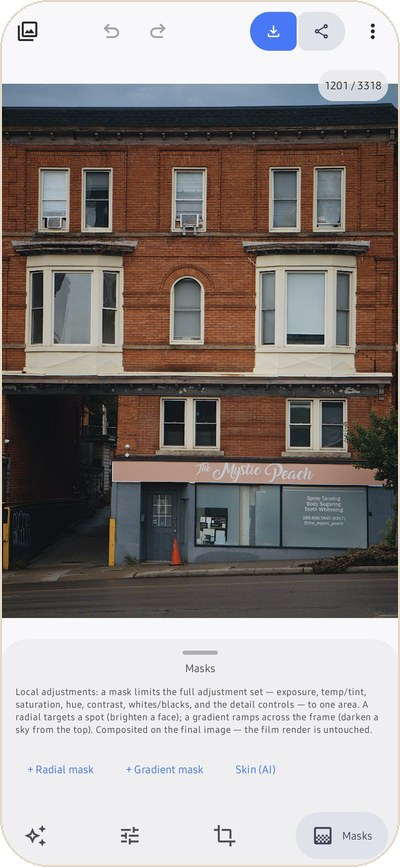

<picture>
  <source media="(prefers-color-scheme: dark)" srcset="docs/images/hero-dark.png">
  
</picture>

 

Film modeling powered by [spektrafilm](https://github.com/andreavolpato/spektrafilm).
Free and open source. No account, no ads, no tracking.

## See it

<table>
  <tr>
    <td align="center" width="25%">
      <picture>
        <source media="(prefers-color-scheme: dark)" srcset="docs/images/looks-dark.jpg">
        
      </picture>
       <b>Looks</b> Pick a film, then a paper
    </td>
    <td align="center" width="25%">
      <picture>
        <source media="(prefers-color-scheme: dark)" srcset="docs/images/edit-dark.jpg">
        
      </picture>
       <b>Edit</b> Light, color, film, print, effects
    </td>
    <td align="center" width="25%">
      <picture>
        <source media="(prefers-color-scheme: dark)" srcset="docs/images/crop-dark.jpg">
        
      </picture>
       <b>Crop</b> Straighten, ratios, rotate
    </td>
    <td align="center" width="25%">
      <picture>
        <source media="(prefers-color-scheme: dark)" srcset="docs/images/masks-dark.jpg">
        
      </picture>
       <b>Masks</b> Radial, gradient and AI skin
    </td>
  </tr>
</table>

Real screens from a phone, editing a RAW file. They follow your GitHub light or dark theme.

## What it does

<table>
  <tr>
    <td width="33%" valign="top">
      <h3>Real film stocks</h3>
      Portra, Ektar, Gold, Vision3, Velvia, Provia, Kodachrome, Tri-X, HP5 and more: 25 films and
      9 papers and print stocks, each simulated from measured spectral data. Any colour film prints on any paper.
    </td>
    <td width="33%" valign="top">
      <h3>Six looks to start</h3>
      The app ships 6 built-in presets: Portra 400, Gold 200, Ektar 100, CineStill 800T,
      Kodachrome 64 and Tri-X 400. Tap one, set the amount, then save your own presets and share them as files.
    </td>
    <td width="33%" valign="top">
      <h3>A full editor</h3>
      Exposure, highlights and shadows, white balance, tone curves, grain, halation, diffusion
      filters, enlarger filtration, paper grade, date stamp, history and versions.
    </td>
  </tr>
  <tr>
    <td width="33%" valign="top">
      <h3>Local masks</h3>
      Radial, gradient and color-range masks, plus a skin mask that finds people on the phone.
      Your photo is never uploaded.
    </td>
    <td width="33%" valign="top">
      <h3>RAW in, originals safe</h3>
      RAW and DNG decode through LibRaw. Edits live in a small sidecar keyed to the photo, so the
      original file is never changed.
    </td>
    <td width="33%" valign="top">
      <h3>Real export</h3>
      JPEG, PNG 8/16 and TIFF 16/32-bit float in six color spaces with ICC tags, print
      borders and film-strip frames, and your look as a <code>.cube</code> or CLF 3D LUT. Ultra HDR is experimental.
    </td>
  </tr>
</table>

## How it works

Most film filters are a color LUT that pushes your pixels toward a mood. Spektrafilm runs the
darkroom process itself, the way light and chemistry would:

<picture>
  <source media="(prefers-color-scheme: dark)" srcset="docs/images/chain-dark.png">
  
</picture>

The engine is a C++ port of Andrea Volpato's [spektrafilm](https://github.com/andreavolpato/spektrafilm).
Every stage was checked against the original Python engine and holds to oracle tolerance
(`max_abs ≤ 1e-4`, `rms ≤ 1e-5`). The app renders on the GPU and checks itself against the CPU
engine on each device. [Read more about the pipeline and its accuracy.](docs/how-it-works.md)

## Films and papers

| Type | Stocks |
|---|---|
| **Color negative** | Portra 160 · Portra 400 · Portra 800 (+ push 1, push 2) · Ektar 100 · Gold 200 · UltraMax 400 · Pro 400H · C200 · X-Tra 400 · CineStill 800T |
| **Cinema** | Vision3 50D · 250D · 200T · 500T · Verita 200D |
| **Slide** | Velvia 100 · Provia 100F · Ektachrome 100 · Kodachrome 64 |
| **Black and white** | Tri-X 400 · HP5 Plus 400 · T-Max 100 · Neopan Acros 100 II |
| **Papers** | Portra Endura · Endura Premier · Supra Endura · Ultra Endura · Ektacolor Edge · Crystal Archive Type II · Multigrade IV RC · Vision 2383 · Vision Premier 2393 |

What each one is good for, and which paper to pair it with, is in
[Films and papers](docs/films-and-papers.md).

## Install

1. Download the APK from the [latest release](https://github.com/thetechgeekko/Spektrafilm-android/releases/latest).
2. Open it. Android asks once to allow installs from your browser or file manager.
3. Pick a photo and tap a look. New versions arrive inside the app.

Android 7.0 or later on arm64, 32-bit ARM or x86_64. [Step-by-step install guide.](docs/getting-started.md)

## Documentation

| Guide | What's in it |
|---|---|
| [Getting started](docs/getting-started.md) | Install, the Library, your first edit, updates |
| [Editing guide](docs/editing.md) | Looks, Edit, Crop and Masks, tab by tab |
| [Films and papers](docs/films-and-papers.md) | Every stock, what it's for, how to pair it |
| [Exporting](docs/exporting.md) | Formats, color spaces, frames, LUTs, large images |
| [How it works](docs/how-it-works.md) | The spectral pipeline and how accuracy is checked |
| [FAQ](docs/faq.md) | Common questions, privacy and reporting a bug |

Building the app or changing the engine? Start with [CONTRIBUTING.md](CONTRIBUTING.md) and
the [maintainer docs](docs/README.md#for-maintainers) (the authority order is in
[`docs/EXECUTION_INDEX.md`](docs/EXECUTION_INDEX.md)).

## Credits

- **[spektrafilm](https://github.com/andreavolpato/spektrafilm)** by **Andrea Volpato** is the
  engine this app ports. The spectral science, film profiles and LUTs are his work. If the app is
  useful to you, please star spektrafilm and read his write-up on
  [discuss.pixls.us](https://discuss.pixls.us/t/spectral-film-simulations-from-scratch/48209).
- **[colour-science](https://www.colour-science.org/)** for the colour matching functions,
  illuminants and transforms that define what "correct" means here.
- **[LibRaw](https://www.libraw.org/)** for on-device RAW and DNG decoding.
- The **[pixls.us](https://pixls.us)** community. This app is dedicated to you.

## Author

Built and directed by **Akshay**.
[Instagram @akshay.pool](https://www.instagram.com/akshay.pool/) ·
[YouTube @Akshayishere](https://www.youtube.com/@Akshayishere/videos)

If the app brings you something, say hi and share your photos.

## License

GPL-3.0. See [`LICENSE`](LICENSE) and [`NOTICE.md`](NOTICE.md). Because this is a derivative of the
GPLv3 spektrafilm engine, the whole app is GPLv3. Please keep it open.

### Using this code in your own app

You are welcome to, including commercially. Two obligations come with it.

**1. GPLv3.** A work based on this one is GPLv3 too, and you must offer your users the
corresponding source. Shipping it inside a closed-source app is not permitted.

**2. Attribution (a required notice under [GPLv3 §7(b)](NOTICE.md)).** Display this in your
about / credits / licences screen, or your store listing, with both links clickable where the
medium allows:

> **Spektrafilm for Android** by **Akshay Sharma** —
> <https://github.com/thetechgeekko/Spektrafilm-android>
>
> Film modeling powered by **spektrafilm** (Andrea Volpato) —
> <https://github.com/andreavolpato/spektrafilm>

Both lines, please. The film-simulation engine is a port of Andrea Volpato's spektrafilm, so
crediting this port while dropping the upstream engine would misrepresent whose work you are
shipping. The full term is in [`NOTICE.md`](NOTICE.md).
