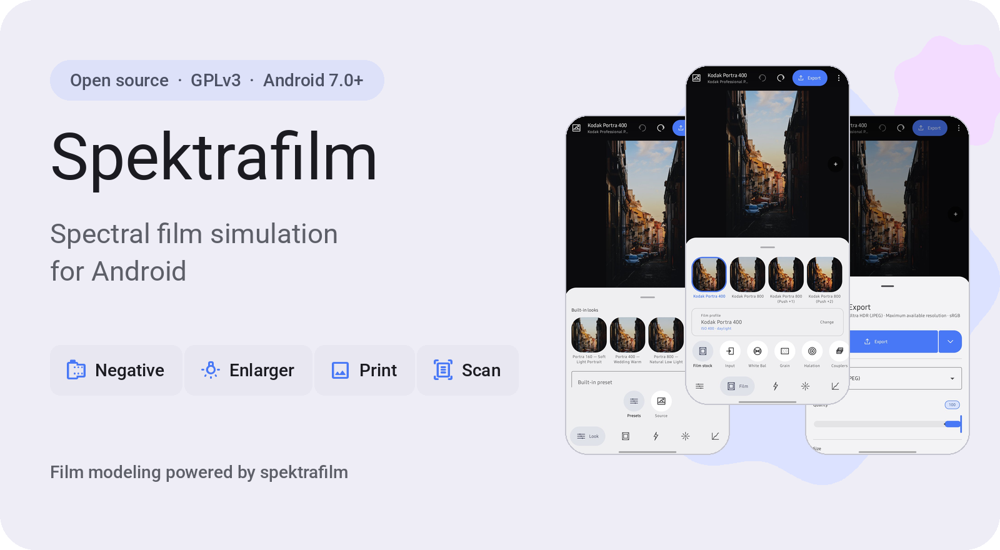
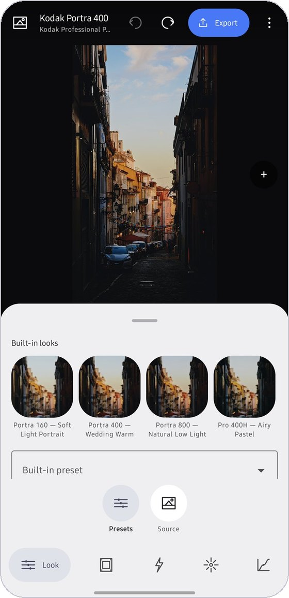
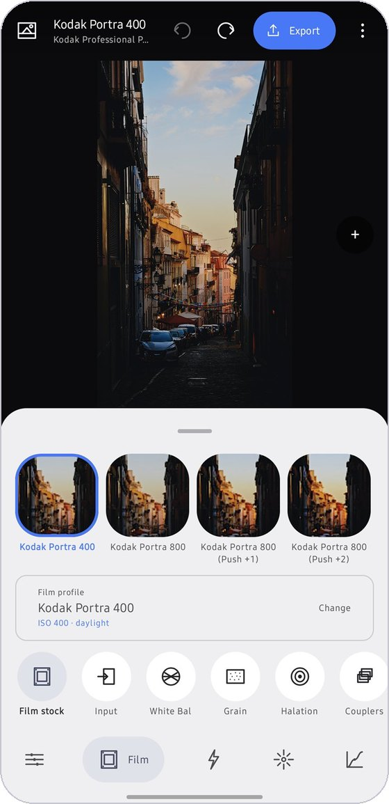
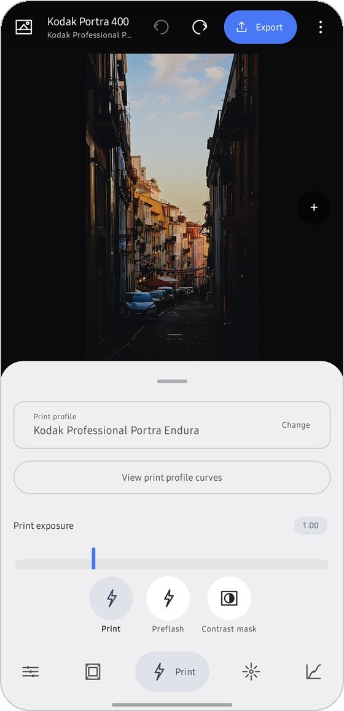
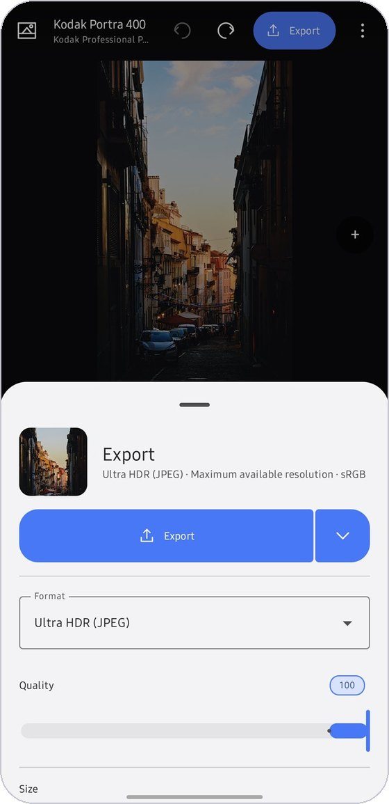

<picture>
  <source media="(prefers-color-scheme: dark)" srcset="docs/readme/hero-dark.png">
  
</picture>

# Spektrafilm for Android

**Spectral film simulation on your phone.** Not a colour LUT: a physically based simulation of the
whole analog chain, from negative to enlarger to print to scan.

Film modeling powered by [spektrafilm](https://github.com/andreavolpato/spektrafilm).
Dedicated to the [pixls.us](https://pixls.us) community.

 

## What you can do

<table>
  <tr>
    <td width="33%" valign="top">
      <h3>Pick a film, then a paper</h3>
      28 film and paper profiles (colour negative, slide, motion picture, print film and RGB
      papers), each with its ISO, colour balance and era. Any film prints on any paper.
    </td>
    <td width="33%" valign="top">
      <h3>Start from a look</h3>
      27 built-in presets cover researched film and print pairings. Tap one to apply it, then
      save your own and share them as files.
    </td>
    <td width="33%" valign="top">
      <h3>Tune the chain</h3>
      Exposure and metering, DIR couplers, halation and scatter, diffusion filters, the
      enlarger's dichroic filters, grain with sublayers, and the scanner.
    </td>
  </tr>
  <tr>
    <td width="33%" valign="top">
      <h3>Edit like a photographer</h3>
      Tone curves (master and per channel), contrast, saturation and vibrance, plus radial,
      gradient and colour range masks. Local edits sit on top of the film render.
    </td>
    <td width="33%" valign="top">
      <h3>Bring RAW, keep originals</h3>
      RAW and DNG decode through a pinned LibRaw. Edits live in a sidecar keyed to the source,
      so the original file is never touched.
    </td>
    <td width="33%" valign="top">
      <h3>Export real files</h3>
      JPEG, PNG 8/16 and TIFF 16/32F in six output spaces with ICC tags, a scene-linear TIFF for
      grading elsewhere, and the look baked as a <code>.cube</code> or CLF 3D LUT.
    </td>
  </tr>
</table>

## The app

The editor is built image first, with Material 3: the photo fills the screen, the stages of the
chain sit in one row along the bottom, and each stage opens its own tools in a sheet you can
pull up or push away.

<table>
  <tr>
    <td align="center" width="25%">
      <picture>
        <source media="(prefers-color-scheme: dark)" srcset="docs/readme/look-dark.jpg">
        
      </picture>
       <b>Look</b> Built-in looks, rendered live on your photo
    </td>
    <td align="center" width="25%">
      <picture>
        <source media="(prefers-color-scheme: dark)" srcset="docs/readme/film-dark.jpg">
        
      </picture>
       <b>Film</b> Stock, white balance, grain, halation
    </td>
    <td align="center" width="25%">
      <picture>
        <source media="(prefers-color-scheme: dark)" srcset="docs/readme/print-dark.jpg">
        
      </picture>
       <b>Print</b> Paper, exposure, preflash
    </td>
    <td align="center" width="25%">
      <picture>
        <source media="(prefers-color-scheme: dark)" srcset="docs/readme/export-dark.jpg">
        
      </picture>
       <b>Export</b> Format, quality and size in one sheet
    </td>
  </tr>
</table>

Light and dark screens follow your GitHub theme. Sample photo: "Golden hour in Lisbon" by
[Ted Moravec](https://www.flickr.com/photos/tmoravec/52211117676/), CC0, via
[Wikimedia Commons](https://commons.wikimedia.org/wiki/File:Golden_hour_in_Lisbon_(52211117676).jpg).

## How it works

Most film looks are a colour LUT that nudges your pixels toward a mood. Spektrafilm runs the
process itself, the way it happens in a darkroom:

1. **Negative.** Each pixel gets a reconstructed spectrum, which exposes a virtual emulsion with
   real spectral sensitivities. The dyes develop through the film's measured density curves.
2. **Enlarger.** The negative is projected through dichroic filters, as on a colour enlarger.
3. **Print.** The light lands on a virtual paper with its own curves.
4. **Scan.** The print is scanned back into the colour space you export in.

White balance knows about film too: "balance to film stock" warms the input to a tungsten stock's
reference light, the digital version of an 85 filter, so tungsten film doesn't render a daylight
scene blue.

The engine is a parity-first C++ port of Andrea Volpato's research project. The science, film
measurements and spectral data are upstream work; this project brings them to Android.

## Install

1. Download the latest APK from
   [Releases](https://github.com/thetechgeekko/Spektrafilm-android/releases/latest).
2. Allow installs from unknown sources when Android asks.
3. Open it, pick a photo, and tap a look.

You need Android 7.0 (API 24) or later. The native engine ships for arm64-v8a, armeabi-v7a and
x86_64. CI artifacts are development builds, not production-signed releases.

<b>File formats in detail</b>

 

Supported RAW and DNG files use the pinned, patched LibRaw decoder; unsupported compressed inputs
may use Android's display-referred platform fallback and are not claimed to be RAW or
oracle-identical. The photo picker and a built-in demo image are also available.

Rendered JPEG, PNG8/16 and TIFF16/32F exports offer six output spaces. PNG16 and rendered TIFF
carry the selected ICC profile; bitmap JPEG/PNG8 tagging needs API 26+, falls back to plain sRGB
tagging on API 24–25, and cannot faithfully tag ACES in its 8-bit path. Scene-linear TIFF32F is a
separate pre-simulation export: verbatim decoded input primaries, deliberately untagged and
EXIF-Uncalibrated for grading elsewhere. An experimental Ultra HDR container exists, but its
gain-map and transfer release contract remains open. Source EXIF carry-through currently applies
to JPEG. A baked 3D LUT (`.cube` or CLF) is a synthetic-lattice operation, so it excludes
source-dependent and spatial or stochastic effects.

Latest-upstream coverage and any inert or unavailable controls are tracked explicitly in the
[execution index](docs/EXECUTION_INDEX.md); an older parity baseline is not treated as permanent
full-feature parity.

## Two render routes

| | Fast GPU (what the app runs) | Strict Exact CPU (the reference) |
|---|---|---|
| Runs on | Vulkan compute, f32 | CPU, f64 |
| Contract | tolerance-bounded against the CPU route | matches the oracle within tolerance |
| Determinism | same-device deterministic | byte-identical across worker counts |
| On failure | falls back to the CPU route | — |
| Used as parity evidence | never | yes |

Since v0.10.0 the app renders and exports on the GPU route. Each device checks it against the CPU
engine and falls back automatically where they disagree, so there is no setting to choose. A
default export is therefore tolerance-bounded, not byte-identical to the CPU path. Strict Exact
CPU remains the parity-bearing reference: it is what the 48 gated cases measure, and what
"correct" means here. It is not currently selectable from the app.

### A note on accuracy

The port was done parity-first. The real Python engine ran headless as an oracle, golden vectors
of intermediate results were captured, and each stage was ported to C++ and gated against those
vectors. The gate is oracle tolerance (`max_abs <= 1e-4`, `rms <= 1e-5`) plus same-build
worker-count invariance. A `tools/parity` harness and CI enforce 48 cases, twice: at `-O2` and at
the flags the release APK ships with.

<b>Measured difference per stage</b>

 

| Stage | Difference vs the original |
|-------|----------------------------|
| Hanatos2025 spectral upsampling | ~1.1e-7 |
| Filming (expose → develop) + DIR couplers | ~1.2e-7 / 2.4e-7 |
| Printing (enlarger + dichroic filters) | ~2.4e-7 / 5.6e-7 |
| Scanning (spectral → XYZ → RGB) | ~6e-8 |
| Halation + scatter + coupler diffusion | ~1.5e-7 |
| Grain (stochastic) | mean-preserving; noise std matched |

These are representative stage measurements, not a promise of universal byte identity. Identical
bytes are not implied across CPU architectures, compiler builds, CPU and GPU routes, or encoded
containers. Exactness levels and current limitations are in the
[execution index](docs/EXECUTION_INDEX.md).

> [!NOTE]
> **Related project: Latent.** Latent is a computational engine built around the manipulation of
> RAW images, by the same author. Spektrafilm for Android stands on its own and is maintained here.

## Credits

This app stands on open colour science and open source.

- **[spektrafilm](https://github.com/andreavolpato/spektrafilm)** by **Andrea Volpato** is the
  engine this project ports. The spectral science, film-stock profiles and LUTs are all his. If
  this is useful to you, please star spektrafilm and read his write-up on
  [discuss.pixls.us](https://discuss.pixls.us/t/spectral-film-simulations-from-scratch/48209).
- **[colour-science](https://www.colour-science.org/)**, whose colour matching functions,
  illuminants and transforms define what "correct" means here.
- **[LibRaw](https://www.libraw.org/)** for on-device RAW and DNG decoding.
- The **[pixls.us](https://pixls.us)** community, for keeping open photography and open colour
  science alive and welcoming. This app is dedicated to you.

## Documentation

<b>Start here, contracts, release and process</b>

 

**Start here**

- [`docs/EXECUTION_INDEX.md`](docs/EXECUTION_INDEX.md): current authority order and live-work loop
- [`docs/ARCHITECTURE.md`](docs/ARCHITECTURE.md): engine and app architecture

**Contracts**

- [`docs/BIT_IDENTICAL_EXPORT_ROADMAP.md`](docs/BIT_IDENTICAL_EXPORT_ROADMAP.md): exactness and performance
- [`docs/JNI_LIFETIME_SAFETY.md`](docs/JNI_LIFETIME_SAFETY.md): the native boundary
- [`docs/TRANSACTIONAL_STORAGE.md`](docs/TRANSACTIONAL_STORAGE.md): storage and URI access
- [`docs/LICENSING.md`](docs/LICENSING.md): licence obligations
- [`docs/RAW_DNG.md`](docs/RAW_DNG.md): RAW/DNG decode notes

**Release and process**

- [`docs/RELEASE_CHECKLIST.md`](docs/RELEASE_CHECKLIST.md): maintainer release checklist
- [`docs/PRODUCTION_READINESS_PLAN.md`](docs/PRODUCTION_READINESS_PLAN.md): release acceptance
- [`CONTRIBUTING.md`](CONTRIBUTING.md): how to build, gate and submit a change
- [`SECURITY.md`](SECURITY.md): reporting a vulnerability
- [`CHANGELOG.md`](CHANGELOG.md): what changed, per version
- [`tools/parity/`](tools/parity/): the golden-vector parity harness
- [`tools/readme/`](tools/readme/): rebuilds the art on this page

Dated files (`docs/AUDIT.md`, `docs/*_2026-*.md`) and `docs/research/**` record findings from when
they were written. They are evidence, not a work queue.

## Author

Built and directed by **Akshay**.
[Instagram @akshay.pool](https://www.instagram.com/akshay.pool/) ·
[YouTube @Akshayishere](https://www.youtube.com/@Akshayishere/videos)

If the app brings you something, say hi and share your renders.

## License

GPL-3.0. See [`LICENSE`](LICENSE) and [`NOTICE.md`](NOTICE.md). Because this is a derivative of the
GPLv3 spektrafilm engine, the whole app is GPLv3. Please keep it open.

### Using this code in your own app

You are welcome to. That is what the licence is for, including commercially. Two obligations
come with it.

**1. GPLv3.** A work based on this one is GPLv3 too, and you must offer your users the
corresponding source. Shipping it inside a closed-source app is not permitted.

**2. Attribution (a required notice under [GPLv3 §7(b)](NOTICE.md)).** Display this in your
about / credits / licences screen, or your store listing, with both links clickable where the
medium allows:

> **Spektrafilm for Android** by **Akshay Sharma** —
> <https://github.com/thetechgeekko/Spektrafilm-android>
>
> Film modeling powered by **spektrafilm** (Andrea Volpato) —
> <https://github.com/andreavolpato/spektrafilm>

Both lines, please. The film-simulation engine is a port of Andrea Volpato's spektrafilm, so
crediting this port while dropping the upstream engine would misrepresent whose work you are
shipping. The full term, and exactly what it does and does not require, is in
[`NOTICE.md`](NOTICE.md).
