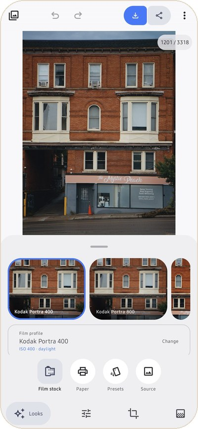
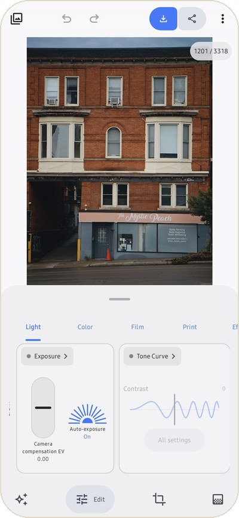
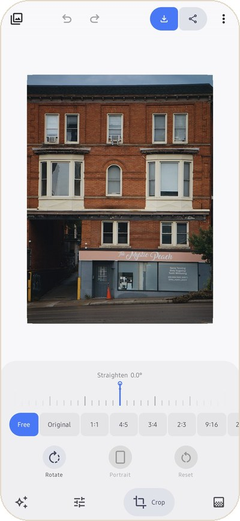
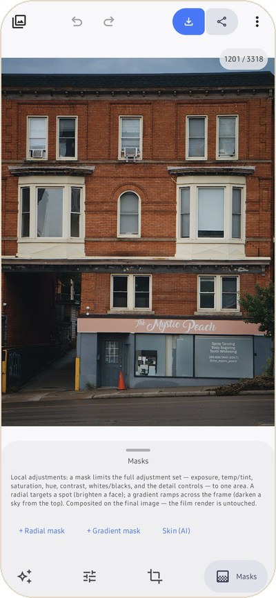

# Editing guide

The editor has four tabs along the bottom. **Looks** picks the film and the paper, **Edit**
fine-tunes everything, **Crop** frames the shot and **Masks** changes one part of the photo. Tap a
tab to open its tools; tap it again, or swipe the panel down, to see the whole photo.

Every change is saved as you go. Your original file is never changed.

## Looks

**Film stock.** The strip shows your photo through each film. Tap a tile to switch. The card
below names the film, its speed and whether it is balanced for daylight or tungsten light. Tap
**Change** for the full list, or tap the film's name to see its curves (spectral sensitivity,
characteristic curves and dye spectra).

**Paper.** What the negative is printed on. A colour film prints on any paper. Black-and-white
films print on Multigrade, where you also get a paper grade.

**Presets.** The six built-in looks and the ones you save. The **Amount** slider mixes the preset
over your previous settings, from 0% (before) to 100% (full). Save your own with **Save current
as preset**, share them as `.json` files, and import presets others send you.

**Source.** Pick another photo, open a RAW or DNG, show the histogram, or reset all edits.

Slide films (Velvia, Provia, Ektachrome, Kodachrome) are positives. When you pick one, the app
offers **Slide mode**, which shows the film itself instead of a print.

 

## Edit

The sections run along the top of the panel. Swipe them sideways. A dot marks a section you
changed, and each tool has its own reset. Drag sideways on the photo to keep adjusting the last
control you touched, or tap a value to type an exact number.

| Section | Tools |
|---|---|
| **Light** | Camera exposure and auto-exposure, tone curve (master and per channel) and contrast, highlights and shadows (fits a scene wider than the film before exposure), contrast mask |
| **Color** | White balance (eyedropper, warmth, tint; Kelvin and as-shot for RAW files; balance to film stock), saturation and vibrance, print color (enlarger yellow and magenta), film color character (DIR couplers) |
| **Film** | Film format (8 mm to 120, which scales grain and halation), grain, halation and scatter, camera diffusion filter |
| **Print** | Print exposure and paper grade, preflash, enlarger lens blur and print diffusion |
| **Effects** | Viewing glare, camera lens blur, date stamp (an LED date imprint that develops with the film) |
| **Detail** | Scan sharpening and white and black points, RAW clean-up (hot pixels, chroma noise) |
| **Frame** | A print border or film strip around the photo, with colour, aspect and caption |
| **Output** | Output color space, gamut compression and preview size |
| **Lab** | Spectral input options and experimental density curves, for people who want the raw controls |

**Balance to film stock** is the digital version of an 85 filter. A tungsten film such as Vision3
500T or CineStill 800T renders a daylight scene blue, the way real film does. Turn this on to warm
the input to the film's reference light.

**Grain** is a particle simulation, not a texture overlay. It is random, so the preview can differ
slightly between renders, and it is computed at full resolution on export.

 

## Crop

- Drag a corner or an edge of the frame to crop. Drag inside it to move.
- **Straighten**: drag the ruler sideways to tilt the photo. Double-tap it to level the photo at 0°.
- **Aspect ratio**: Free, Original, 1:1, 4:5, 3:4, 2:3, 9:16 and more, in portrait or landscape.
- **Rotate** turns the photo 90° at a time. **Reset** returns to the full photo.

The crop is applied when you leave the tab.

 

## Masks

A mask limits a set of adjustments to one area. Masks work on the finished image, so the film
render underneath is untouched.

- **Radial mask** targets a spot, such as a face. Drag it on the photo, then set its size and
  feather.
- **Gradient mask** ramps across the frame, such as darkening a sky from the top.
- **Skin (AI)** finds the people in the photo and selects their face skin, body skin or both, with
  edge softness and expand controls. It runs on your phone. The first time, the app downloads the
  model (about 16 MB) from Google; your photo is never uploaded.

Each mask has exposure, temperature, tint, saturation, hue shift, contrast, highlights, shadows,
whites, blacks, clarity, texture and sharpness. **Limit to tones** restricts a mask to a brightness range, and **Limit to a color** to one colour
family, each with an eyedropper to pick from the photo.
**Invert** applies the adjustment outside the mask, and **Mask opacity** sets how strong it is.

 

## History, versions and sharing an edit

- **Undo and Redo** are at the top. Hold Undo to see the history and jump to any step.
- **Versions** keep several looks of the same photo. Save the current look under a name, then
  switch between them. A version keeps its crop and masks.
- **Copy settings** and **Paste settings** move a whole edit between photos. **Apply previous
  edit** gives this photo the look of the last one you edited. In the Library, **Paste edit** does
  the same for many photos at once.
- **Photo info** in the menu shows the camera, lens, exposure and file details.

Next: [Films and papers](films-and-papers.md), or [Exporting](exporting.md) when you are done.
