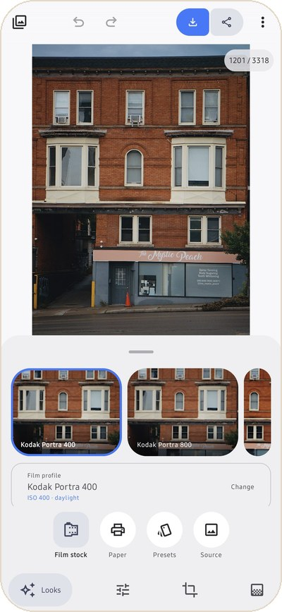

# Getting started

This page takes you from download to your first saved photo. It takes about five minutes.

## Install

1. On your phone, open the [latest release](https://github.com/thetechgeekko/Spektrafilm-android/releases/latest)
   and download the `.apk` file.
2. Open the downloaded file. Android asks once to allow installs from your browser or file
   manager. Allow it, then tap **Install**.
3. Open Spektrafilm. Three short intro screens show what it does. Tap **Get started**.

You need Android 7.0 or later. The app is not on Google Play; GitHub releases are the only
official source.

## Updates

When the app opens, at most once a day, it asks GitHub whether a newer release exists. If one
does, a **What's new** dialog shows that release's notes with three choices:

- **Update** downloads the new APK, checks that it is a genuine Spektrafilm release signed with the
  same key as your copy, and hands it to Android's installer, where you confirm.
- **Later** asks again another day.
- **Skip this version** stays quiet until the next release.

You can turn the automatic check off in **Settings > Check for updates automatically**, and check
by hand with **Check for updates**. A copy you built yourself is never updated in place; it gets
an **Open release page** button instead.

## Get a photo in

Tap the **Library** button at the top left of the editor. The Library has three tabs:

- **Gallery** shows the photos and RAW files on your phone, newest first, with day headers. On
  Android 14 and later you can share only some photos with the app; tap **Change** to pick more.
- **Folder** browses a folder you choose, such as your camera's DCIM folder or an SD card. Photos
  you have edited carry an **Edited** badge.
- **Albums** groups frames from anywhere. An album only lists photos, so the files stay where
  they are. **Import photos** copies photos into an album called **Imported**.

You can also share photos to Spektrafilm from any other app.

In every view you can sort by date, name or size, filter by edited or not edited, search by file
name, switch between square tiles and photo rows, and play a slideshow. Long-press to select
several photos, then share them, add them to an album, export them together, or use **Paste
edit** to give them the look of the photo you have open.

## Your first edit

1. Open a photo. It fills the screen, with four tabs along the bottom: **Looks**, **Edit**,
   **Crop** and **Masks**.
2. Tap **Looks**. Each tile in the film strip shows your own photo through that film. Tap one.
3. Tap **Paper** to choose what it is printed on, or **Presets** for the six built-in looks. The
   **Amount** slider blends a preset over what you had.
4. Open the **⋮** menu and turn on **Before / after compare** for a split view you can drag. On a
   tablet or unfolded phone the compare button sits in the top bar; hold it to see the original.
5. Tap the save button (the arrow pointing down) at the top. The full-quality photo goes to
   `Pictures/Spektrafilm` in your gallery, and a bar lets you share or open it. The share button
   next to it sends the photo straight to another app.

Your edit is saved as you go, and your original file is never changed. Open the same photo later
and the edit comes back.

 

## Quick tips

- **Undo** steps back. Hold it to see every step and jump to any one.
- **Pinch** the photo to zoom. Tap it to check fine detail at full resolution.
- **Drag sideways on the photo** to keep adjusting the last control you touched.
- **Quick help** in the menu points at each part of the screen.
- Use **RAW** files when you have them. A JPEG has already been processed by your camera, so the
  film has less to work with.

Next: the [Editing guide](editing.md) explains every tab.
