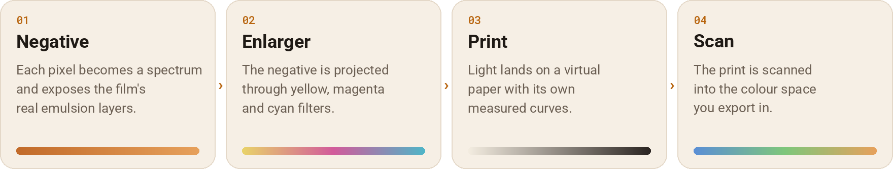

# How it works

Most film filters are a colour lookup table: each input colour is swapped for an output colour
that someone tuned to look like film. Spektrafilm instead simulates what happens to light in a
camera and a darkroom, using measured data for each film and paper. The result changes with your
photo the way real film would: exposure, colour temperature and contrast all behave like film.

<picture>
  <source media="(prefers-color-scheme: dark)" srcset="images/chain-dark.png">
  
</picture>

## The four stages

**1. Negative.** Your photo is RGB, but light is a spectrum. The engine rebuilds a plausible
spectrum for every pixel (a method called spectral upsampling), then exposes the film with it.
Each of the film's three layers responds to wavelengths with its own measured sensitivity. The
layers develop into cyan, magenta and yellow dyes following the film's characteristic curves.
Chemistry between layers (DIR couplers) shifts colours the way real film does. Grain, halation
(light bouncing back through the film base) and scatter inside the emulsion happen here too.

**2. Enlarger.** The negative is projected through yellow, magenta and cyan dichroic filters,
like a colour enlarger. This is where print colour and exposure are set, and where preflash and
the contrast mask act.

**3. Print.** The light lands on a virtual paper with its own sensitivities and curves, and
develops into a print. Black-and-white films print on Multigrade, where the paper grade sets
contrast.

**4. Scan.** The print's dyes are turned back into a spectrum, viewed under a standard light,
and converted to the colour space you export in. Slide films skip the print: in Slide mode the
film itself is scanned.

## Where the science comes from

The engine is a C++ port of [spektrafilm](https://github.com/andreavolpato/spektrafilm) by Andrea
Volpato, a research project in Python. The spectral science, the film and paper measurements and
the lookup tables are his work. Colour matching functions, illuminants and transforms come from
[colour-science](https://www.colour-science.org/). This app brings the engine to phones and adds
an editor around it.

## How accuracy is checked

The port was done one stage at a time against the original. The Python engine ran as a
reference (an "oracle"), its results were saved as test vectors, and each C++ stage had to match
them before it was accepted. The match is oracle tolerance: the largest difference per value is at
most 1e-4 and the average (RMS) at most 1e-5. Results must also be identical however many
processor cores do the work.

More than 50 of these checks run in CI, twice: once at standard compiler settings and once at the
exact settings the released app is built with. Measured differences per stage are around 1e-7,
far below anything visible.

Features the original engine does not have, such as the highlights and shadows control, the
contrast mask, the date stamp and the black-and-white films, are checked for consistency instead:
they must do nothing when off, and behave predictably when on.

## GPU and CPU

On your phone the app renders on the GPU through Vulkan, which is much faster. On each device the
app checks the GPU against the CPU engine and falls back to the CPU automatically where they
disagree. The CPU engine is the reference that the accuracy checks above measure. GPU results stay
within a small tolerance of it, but are not byte-for-byte identical, and results can also differ
slightly between phones with different processors.

Two quality levels mirror the original: a smaller **preview** for interactive editing, sized for
your phone, and the full-resolution **scan** for export.
